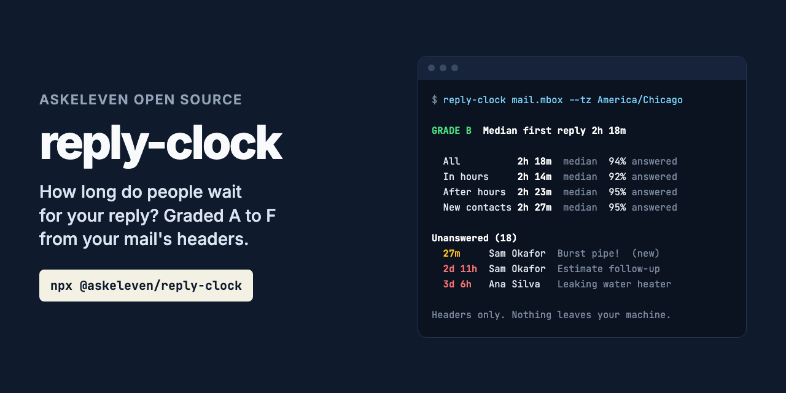
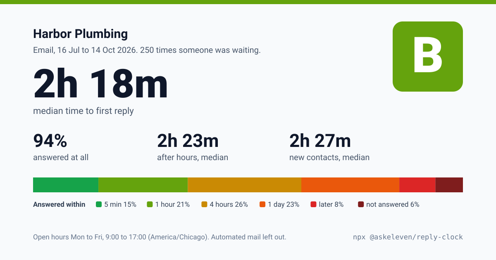

# reply-clock



**How long do people wait for your reply? Your mail already knows.**

```bash
npx @askeleven/reply-clock "All mail Including Spam and Trash.mbox" --card card.svg
```

```
GRADE B  Median first reply 2h 18m, 94% answered

      Mail         office@harborplumbing.test (sent folder)
      Period       16 Jul to 14 Oct 2026, 566 messages, 78 automated left out
      Open hours   Mon to Fri, 9:00 to 17:00, America/Chicago
      People       191 people were waiting 252 times

  All          2h 18m     median    94% answered     250 times
  In hours     2h 14m     median    92% answered     123 times
  After hours  2h 23m     median    95% answered     127 times
  New contacts 2h 27m     median    95% answered     187 times
  Slowest 10%  21h 57m or more

  Answered within 5 min 38, 1 hour 52, 4 hours 66, a day 57, later 21. Never: 16.

Unanswered (18)
  under 1m Ana Silva <ana9@example.com>  Can you come Tuesday?
  27m      Sam Okafor <sam24@example.com>  Burst pipe!  (new)
  2d 11h   Sam Okafor <sam22@example.com>  Estimate follow-up  (missed)
  and 15 more; --list 18 shows them all
```

(From a made-up mailbox; yours will differ.)

Most small businesses have no idea how long their customers wait. The inbox shows what is
unread, not what is unanswered, and nobody times it. A new lead who waits half a day has
often already booked whoever answered first.

reply-clock times it. Give it a mail export, or let it read your mailbox over IMAP, and it
finds every time a person wrote to you and was left waiting, and how long until you
answered, if you did. Then it grades you, A to F, on a scale anyone can check.

It reads headers only: who wrote to whom, when, and in reply to what. Never a message body.
Zero dependencies. Nothing leaves your machine.

**No terminal?** [Drop your export on the web page](https://askeleven.github.io/reply-clock/).
It runs the same code in your browser, and the page is not allowed to connect to anything,
so your mail cannot leave it.

---

## The report card

`--card card.svg` writes this. It shows totals only: no names, addresses or subjects. It is
made to share. The web page also gives it as a PNG.



`--html report.html` writes the full report: the card, the numbers, a chart of when people
write to you against your open hours, and everyone still unanswered. That one names
people, so it is for you.

## How it counts

**A wait** starts when a person writes to you and ends at your first reply in that
conversation. If they write again before you answer, it is still the same wait, timed from
their first message.

**Conversations** are joined by Message-ID, In-Reply-To and References, by Gmail's thread
id, and, where the earlier message is not in the export, by subject with the same person.

**Your replies** are mail from your addresses. Give them with `--me`; otherwise they are the
senders of your Sent folder or label. Add `--domain acme.com` and a reply from any
colleague counts too.

**Missed** means never answered and more than 48 hours old when the mail ends. Anything
younger is still open: it is listed, and left out of the numbers, because it may yet be
answered.

**Left out as automated**: mailing lists (List-Id, List-Unsubscribe), bulk mail
(Precedence: bulk, Feedback-ID), auto-replies (Auto-Submitted), bounces, no-reply and
notification senders, and anything labeled Spam. Nobody is waiting on those.

**Contact forms count.** A website form that mails you from no-reply@ with the customer in
Reply-To is a lead waiting for an answer, and is timed as one.

**After hours** is outside `--hours`, default Monday to Friday 9 to 5, in `--tz`, default
this machine's time zone. **New contacts** are people writing to you for the first time in
the mail you gave it.

### The grade

| Grade | Median first reply | And answered |
|---|---|---|
| **A** | within 1 hour | 90% or more |
| **B** | within 4 hours | 80% or more |
| **C** | within a day | 70% or more |
| **D** | within 3 days | 50% or more |
| **F** | anything slower | |

Both have to hold. Answering in four minutes but ignoring a third of people is not an A.

## Getting your mail

**Gmail**: [Google Takeout](https://takeout.google.com/), Mail only. The file
`All mail Including Spam and Trash.mbox` has your inbox and sent mail, with labels, so your
address is found for you. Spam is left out.

**Apple Mail**: select Inbox, then Mailbox, Export Mailbox. Do the same for Sent. Give
reply-clock both `.mbox` folders.

**Thunderbird**: the ImportExportTools NG add-on exports folders as mbox.

**Any folder of `.eml` files** works too.

**Straight from the server**, over IMAP, with an app password:

```bash
export REPLY_CLOCK_PASSWORD='your app password'
npx @askeleven/reply-clock imap --host imap.gmail.com --user you@yourbusiness.com
```

It opens folders read-only and fetches headers with `BODY.PEEK`, so nothing is marked read,
moved or deleted. It reads All Mail if the server has it (Gmail does), else INBOX, plus
Sent, from 60 days before the period so it knows who is new. The password comes from the
environment, never the command line, so it stays out of your shell history. It is sent
only to the server you name, over TLS.

Gmail, iCloud, Fastmail and Yahoo all give app passwords; Gmail needs 2-Step Verification
on first. **Outlook.com and Microsoft 365** require OAuth for IMAP, which reply-clock does
not do: use an export.

## Options

```
reply-clock <mail export...> [options]
reply-clock imap --host <server> --user <address> [options]

  --me <address>        Your address. Repeatable.
  --domain <domain>     Your business's domain. Repeatable.
  --tz <zone>           Your time zone, such as America/Chicago.
  --hours <hours>       Your open hours. Default "Mon-Fri 9-17".
                        Also "Mon-Sat 8:30-18", "Mon,Wed,Fri 10-16", "every day 0-24".
  --since <when>        A date (2026-07-01) or a span (90d, 12w). Default 90d.
  --until <date>        Default the newest message, or now for imap.
  --card <file.svg>     The report card, totals only.
  --html <file.html>    The full report.
  --business <name>     A name for the top of the card.
  --list <n>            How many unanswered to list. Default 10.
  --json                The whole report as JSON, every wait included.
  --no-colour           Plain text.

imap
  --host, --port (993), --user, --mailbox <name> (repeatable),
  --no-tls (only to a server on this machine). Password: $REPLY_CLOCK_PASSWORD.
```

Exit codes: 0, report written. 2, could not run.

## As a library

```js
import { readMessages, analyze, renderCard, formatText } from '@askeleven/reply-clock'

const messages = await readMessages(['export.mbox'])
const report = analyze(messages, { me: ['office@acme.com'], timeZone: 'America/Chicago' })

report.grade          // 'B'
report.all.median     // ms
report.waiting        // unanswered, newest first
renderCard(report)    // SVG
```

`analyze` takes messages from anywhere: build them with `toMessage(parseHeaders(text))`.
The core (`analyze`, `toMessage`, `mboxHeaders`, `renderCard`) has no Node imports and
runs in a browser; the web page uses it as is.

## What it does not do

**It does not see phone calls, texts or chat.** Email only. If you answered by phone, the
email wait shows as missed.

**It does not judge the reply.** A "Thanks, will look tomorrow" stops the clock the same as a
full answer. That is first reply time, which is what customers feel first.

**It cannot see mail you did not give it.** Reply from a different account, and those
replies are missing. Give every address with `--me`, and every mailbox.

**It does not send your mail anywhere.** No network, except the IMAP server you name.

## Part of AskEleven open source

Small tools for businesses that let software talk to their customers. More at
[github.com/askeleven](https://github.com/askeleven).

MIT licensed.

After a successful run in an interactive terminal, the CLI prints one line asking for a GitHub star, at most once a week. It never shows in CI, in `--json` output, in pipes or when running as an MCP server. Set `ASKELEVEN_NO_STAR=1` to turn it off.

